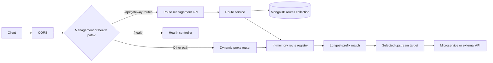

# Dynamic Route Management

## Overview

Phase 4 replaces the hard-coded proxy prefix table with a MongoDB-backed route registry. Routes can
be created, edited, enabled, disabled, and deleted at runtime through the gateway management API.
Phase 5 extends routes with multiple backends and health-aware load balancing. The active route set
is held in memory as an immutable snapshot, so proxied requests do not query MongoDB for route
configuration. Phase 8 adds optional authentication policy to that same route snapshot.

The proxy engine remains `http-proxy-middleware`. A single shared proxy instance resolves a healthy
backend from the matched route on each request, which allows route and backend changes to take effect
immediately without restarting the gateway.



## Route Model

Routes are stored in the `routes` collection of the `dynamic_api_gateway` database.

| Field | Type | Required | Description |
| --- | --- | --- | --- |
| `name` | String | Yes | Unique descriptive route name, up to 100 characters |
| `path` | String | Yes | Unique gateway path prefix beginning with `/` |
| `target` | String | Yes | Legacy-compatible target, synchronized to the first backend |
| `backendInstances` | Object[] | Yes | Configured backends: stable `id`, `target`, `enabled`, optional `weight` and `healthCheckPath` |
| `loadBalancingStrategy` | String | Yes | `round_robin`, `least_connections`, or `random` |
| `methods` | String[] | Yes | Non-empty list of allowed HTTP methods |
| `description` | String | No | Optional description, up to 500 characters |
| `enabled` | Boolean | No | Defaults to `true`; disabled routes are not proxied |
| `stripPrefix` | Boolean | No | Defaults to `false`; removes the matched route prefix |
| `authRequired` | Boolean | No | Defaults to `false`; require a valid RS256 bearer token |
| `requiredRoles` | String[] | No | Defaults to `[]`; if set, a verified token must match at least one configured role |
| `createdAt` | Date | Automatic | Creation timestamp |
| `updatedAt` | Date | Automatic | Last update timestamp |

Route creation and updates accept `backends` as an alias for `backendInstances`, and `strategy` as
an alias for `loadBalancingStrategy`. Legacy `target`-only payloads remain supported and represent
a single backend. Runtime health state is not persisted; the monitor owns that transient state.
`weight` is accepted and returned as metadata but does not affect the three supported strategies.
Authentication settings are persisted with the route and reloaded through the existing registry;
verification keys are never stored in MongoDB.

Supported methods are `GET`, `POST`, `PUT`, `PATCH`, `DELETE`, `HEAD`, and `OPTIONS`. All default
routes include `HEAD` because their corresponding backends expose GET handlers. HEAD requests are
proxied and return headers/status without a response body.

Paths are normalized by trimming whitespace, collapsing repeated slashes, and removing trailing
slashes. A path cannot contain query parameters, fragments, whitespace, or backslashes. Route names
and normalized paths must be unique.

Reserved gateway path prefixes are rejected:

- `/health`
- `/api/gateway`

## Default Routes

On startup, the gateway creates any missing default routes. Existing routes are never overwritten.
Initialization is idempotent across restarts.

| Name | Path | Backends | Strategy | Methods |
| --- | --- | --- | --- | --- |
| User Service | `/api/users` | `USER_SERVICE_URL` (`http://localhost:5001`), `USER_SERVICE_URL_2` (`http://localhost:5002`) | Round Robin | `GET, HEAD, POST, PUT, DELETE` |
| Product Service | `/api/products` | `PRODUCT_SERVICE_URL` (`http://localhost:5003`) | Round Robin | `GET, HEAD, POST, PUT, DELETE` |
| Order Service | `/api/orders` | `ORDER_SERVICE_URL` (`http://localhost:5005`) | Round Robin | `GET, HEAD, POST, PATCH, DELETE` |
| Payment Service | `/api/payments` | `PAYMENT_SERVICE_URL` (`http://localhost:5007`) | Round Robin | `GET, HEAD, POST` |

Existing default routes are migrated to include stable backend IDs and the default strategy without
overwriting their configured targets or other administrator changes.

## Registry Lifecycle

The registry stores immutable `allRoutes` and `activeRoutes` snapshots. A snapshot is fully validated
and frozen before it replaces the current one, so a failed update cannot leave a partially applied
route table.

Registry status values:

| Status | Meaning |
| --- | --- |
| `not_loaded` | Initialization has not completed |
| `loaded` | A valid route snapshot is active |
| `error` | Route data could not be loaded or initialized |

Successful loads set `stale: false` and record `lastLoadedAt`. A management operation that cannot
reach MongoDB leaves the previous snapshot active and marks the registry `stale: true`. A subsequent
successful `POST /api/gateway/routes/refresh` reloads the snapshot and clears the stale state.

The backend health monitor follows route snapshot changes. It stops checking removed or disabled
backends and begins checking new or re-enabled backends. Configurable interval, timeout, failure,
and recovery thresholds are documented in [gateway.md](gateway.md). A backend is excluded from
selection after the failure threshold and restored after the recovery threshold.

Startup order is deliberate: connect to MongoDB, initialize missing defaults, load the registry, then
start listening on the gateway port. If MongoDB is unavailable, the gateway still starts after the
connection attempt fails, and reports `routeRegistry.status: "error"`.

## Management API

All management endpoints are under `/api/gateway/routes`. The router uses a scoped JSON body parser,
so management JSON never consumes proxied request bodies.

| Method | Endpoint | Purpose |
| --- | --- | --- |
| `GET` | `/api/gateway/routes` | List all routes and registry statistics |
| `GET` | `/api/gateway/routes/:id` | Get one route |
| `POST` | `/api/gateway/routes` | Create a route |
| `PUT` | `/api/gateway/routes/:id` | Update one or more route fields |
| `PATCH` | `/api/gateway/routes/:id/toggle` | Toggle or explicitly set `enabled` |
| `DELETE` | `/api/gateway/routes/:id` | Delete a route |
| `POST` | `/api/gateway/routes/refresh` | Reload the registry from MongoDB |

### Create a route

```bash
curl -X POST http://localhost:8000/api/gateway/routes \
  -H "Content-Type: application/json" \
  -d "{\"name\":\"Catalog API\",\"path\":\"/catalog\",\"target\":\"http://localhost:5010\",\"methods\":[\"GET\",\"POST\"],\"description\":\"External catalog API\",\"enabled\":true,\"stripPrefix\":false}"
```

Example response:

```json
{
  "success": true,
  "message": "Route created successfully",
  "data": {
    "_id": "6af2b313157bd2afc706d0b5",
    "id": "6af2b313157bd2afc706d0b5",
    "name": "Catalog API",
    "path": "/catalog",
    "target": "http://localhost:5010",
    "methods": ["GET", "POST"],
    "description": "External catalog API",
    "enabled": true,
    "stripPrefix": false,
    "authRequired": false,
    "requiredRoles": [],
    "createdAt": "2026-11-10T06:00:00.000Z",
    "updatedAt": "2026-11-10T06:00:00.000Z"
  }
}
```

### Update a route

`PUT` accepts any subset of `name`, `path`, `target`, `methods`, `description`, `enabled`,
`stripPrefix`, `authRequired`, and `requiredRoles`. Duplicate names or paths are rejected.

```bash
curl -X PUT http://localhost:8000/api/gateway/routes/ROUTE_ID \
  -H "Content-Type: application/json" \
  -d "{\"target\":\"http://localhost:5011\"}"
```

The new target is used by the next proxied request. No gateway restart is required.

Enable JWT verification and an optional role policy in the same update:

```bash
curl -X PUT http://localhost:8000/api/gateway/routes/ROUTE_ID \
  -H "Content-Type: application/json" \
  -d "{\"authRequired\":true,\"requiredRoles\":[\"operator\"]}"
```

The policy takes effect immediately. See [authentication.md](authentication.md) for token
verification and [secret-manager.md](secret-manager.md) for AWS/local JWKS providers.

### Toggle a route

Calling toggle without a body flips the current state. To set an explicit state:

```bash
curl -X PATCH http://localhost:8000/api/gateway/routes/ROUTE_ID/toggle \
  -H "Content-Type: application/json" \
  -d "{\"enabled\":false}"
```

A disabled route is removed from the active snapshot and returns `404 ROUTE_NOT_FOUND` when
requested. Re-enabling it restores proxying immediately.

### Configure multiple backends

Routes can be created or updated with a backend list and strategy. Each backend can be enabled or
disabled independently:

```json
{
  "name": "Catalog API",
  "path": "/catalog",
  "backends": [
    { "id": "catalog-a", "target": "http://localhost:5010", "enabled": true },
    { "id": "catalog-b", "target": "http://localhost:5011", "enabled": true }
  ],
  "loadBalancingStrategy": "least_connections",
  "methods": ["GET", "HEAD", "OPTIONS"]
}
```

Supported strategies are `round_robin`, `least_connections`, and `random`. Only healthy, enabled
backends on enabled routes are eligible. If none are available, the gateway returns a structured
`503 SERVICE_UNAVAILABLE`. Runtime health is included in management responses and `/health`, but is
not persisted in MongoDB.

### Refresh the registry

```bash
curl -X POST http://localhost:8000/api/gateway/routes/refresh
```

Use this after MongoDB recovers from an outage, especially when the gateway started without a loaded
route registry.

## Matching Rules

1. Only enabled routes are eligible.
2. The route with the longest matching path prefix wins.
3. Prefix matching respects segment boundaries. `/api/users` matches `/api/users` and
   `/api/users/123`, but not `/api/users-extra`.
4. If the path matches an active route but the request method is not allowed, the gateway returns
   `405 METHOD_NOT_ALLOWED` and an `Allow` header.
5. If no active route matches, the gateway returns `404 ROUTE_NOT_FOUND` without forwarding.

Example 405 response:

```json
{
  "success": false,
  "error": "METHOD_NOT_ALLOWED",
  "message": "Method PATCH is not allowed for route \"User Service\"",
  "route": "User Service",
  "path": "/api/users",
  "allowedMethods": ["GET", "POST", "PUT", "DELETE"],
  "timestamp": "2026-11-10T06:01:34.874Z"
}
```

## Path Rewriting

When `stripPrefix` is `false`, the original path and query string are forwarded unchanged:

```text
GET /api/users?page=1
  -> http://localhost:5001/api/users?page=1
```

When `stripPrefix` is `true`, the matched route path is removed. The target URL pathname, if any, is
retained:

```text
Route path:    /public/users
Target:        http://localhost:5001/api/users
Request:       /public/users/123?active=true
Forwarded URL: http://localhost:5001/api/users/123?active=true
```

This also applies to an exact route-path request: `/public/users?active=true` forwards to
`http://localhost:5001/api/users?active=true`.

> **Correction to Example B:** a route with path `/public/users`, target
> `http://localhost:5001`, and `stripPrefix: true` forwards `/public/users` to the backend root
> `/`, not `/api/users`. To reach `/api/users`, configure the target as
> `http://localhost:5001/api/users`. The standard prefix-removal behavior above avoids an ambiguous
> implicit path mapping.

## Response Envelopes and Status Codes

Management responses use a consistent envelope:

```json
{
  "success": true,
  "message": "Routes retrieved successfully",
  "data": [],
  "count": 0,
  "registry": {
    "status": "loaded",
    "totalRoutes": 0,
    "enabledRoutes": 0,
    "disabledRoutes": 0,
    "lastLoadedAt": "2026-11-10T06:00:00.000Z",
    "lastError": null,
    "stale": false
  }
}
```

| Status | Condition |
| --- | --- |
| `200` | Successful read, update, toggle, delete, or refresh |
| `201` | Route created |
| `400` | Invalid payload, path, target, method list, or route ID |
| `404` | Route ID not found |
| `409` | Duplicate route name or path |
| `503` | MongoDB unavailable; existing snapshot remains active if already loaded |

MongoDB writes happen before the in-memory snapshot is updated. If the snapshot update fails, the
gateway attempts a full reload and returns a recovery message when it cannot recover.

## Health Reporting

`GET /health` includes registry statistics alongside the existing database and service metadata:

```json
{
  "routeRegistry": {
    "status": "loaded",
    "totalRoutes": 4,
    "enabledRoutes": 4,
    "disabledRoutes": 0,
    "lastLoadedAt": "2026-11-10T06:00:51.208Z",
    "lastError": null,
    "stale": false
  }
}
```

The health response also includes `loadBalancing` totals and a `routes` array containing each
configured backend's redacted target, enabled state, weight metadata, and current health status.
`services` remains a compatibility summary derived from current routes. Removed or updated routes
do not leave stale entries.

If MongoDB becomes unavailable after a successful load, the proxy continues using the current
snapshot. Management reads and writes return `503`, and `/health` reports `stale: true` after the
failure is observed.

The `services` health field retains its existing array shape, but entries now come from the current
route snapshot and contain each route's name, first target URL, path prefix, and enabled state.
Deleted routes disappear, modified routes update immediately, and disabled routes remain visible
with `routingEnabled: false`.

## CORS and OPTIONS

The gateway CORS middleware runs before route matching. A browser preflight (`OPTIONS` with both
`Origin` and `Access-Control-Request-Method`) is answered by CORS with `204` and is not forwarded to
the upstream. To proxy an explicit upstream `OPTIONS` request, include `OPTIONS` in the route's
`methods` and send an OPTIONS request that is not a browser preflight (for example, without
`Access-Control-Request-Method`). The CORS middleware will continue to add the configured origin
header, then dynamic route matching forwards the request.

## Logging

Management changes are logged to stdout:

```text
[ROUTES] Initialized default route: User Service
[ROUTES] Default route initialization complete: 4 created, 0 existing
[ROUTES] Registry loaded: 4 routes (4 enabled)
[ROUTES] Created route: Catalog API
[ROUTES] Updated route: Catalog API
[ROUTES] Disabled route: Catalog API
[ROUTES] Deleted route: Catalog API
[ROUTES] Registry refreshed successfully
```

Proxy completion logs use the dynamic route name:

```text
[GATEWAY] 2026-11-10T06:01:34.820Z GET /catalog/items?limit=5 -> Catalog API | 200 | 12ms
```

Proxied request bodies, headers, and secrets are not logged. Gateway failures return structured
errors without stack traces, internal addresses, or raw connection details.

## Tests

Run unit, validation, registry, CORS, and local proxy tests without MongoDB:

```bash
npm run test:unit
```

Run management API, default seeding, MongoDB persistence, refresh, and recovery integration tests
against a dedicated MongoDB test database:

```powershell
$env:GATEWAY_TEST_MONGODB_URI = "mongodb://127.0.0.1:27017"
npm run test:integration
```

The integration test derives a unique database name from this connection URI and drops that
database during cleanup. If `GATEWAY_TEST_MONGODB_URI` is unset, the integration test is skipped.

Test counts change as the suite evolves; use the runner output as the authoritative result for a
given execution.

## Known limitations

The following remain outside the current implementation:

- Retries and circuit breaking.
- API keys, rate limiting, and broader access policies.
- Dashboard route-management screens and analytics.
- Request metric persistence and WebSocket proxying.
- Existing management APIs are unauthenticated and must be restricted to trusted callers.
